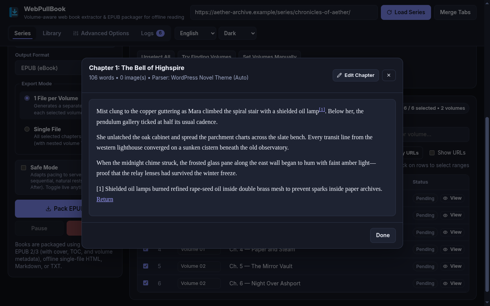
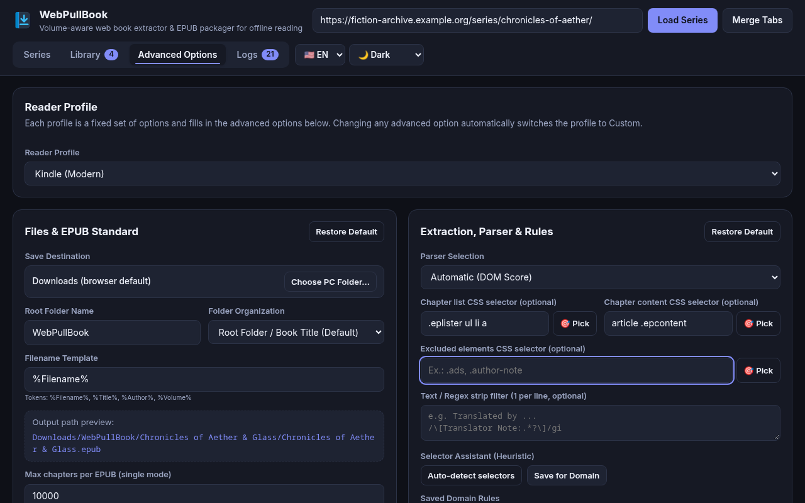

#  WebPullBook

[English](README.md) | **Português**

[](manifest.json)
[](#-primeiros-passos)
[](https://addons.mozilla.org/firefox/addon/webpullbook/)
[](https://github.com/WiltonGabriel/WebPullBook/releases)
[](src/core/zip.js)
[](LICENSE)
[](https://github.com/WiltonGabriel/WebPullBook/actions/workflows/ci.yml)

**WebPullBook** é uma extensão de navegador open source (Chrome, Edge, Brave e Firefox 128+) sem dependências de runtime para **converter páginas web em EPUB** (**Web-to-EPUB**): extrai webnovels, light novels, ficções seriadas, fanfics, blogs, documentações e abas abertas para arquivos **EPUB 2 / EPUB 3** (além de **HTML**, **Markdown** e **TXT**) organizados por volume para leitura offline no **Kindle**, **Kobo**, **Calibre** e celulares.

Firefox Add-ons (AMO): https://addons.mozilla.org/firefox/addon/webpullbook/  
Site oficial: https://wiltongabriel.github.io/WebPullBook/pt/  
Repositório: https://github.com/WiltonGabriel/WebPullBook

[Funcionalidades](#-principais-funcionalidades) • [Instalação](#-primeiros-passos) • [Compatibilidade](#-compatibilidade) • [Perguntas Frequentes](#-perguntas-frequentes-faq) • [Como Ajudar](#-autoria-manutenção-e-contribuições)

---

## Visão Geral

Ler obras longas, artigos ou séries com muitos capítulos em abas do navegador dificulta a leitura offline e em leitores E-Ink, enquanto imprimir PDFs individuais de capítulos costuma gerar quebras de linha inadequadas e problemas de paginação. O WebPullBook busca e sanitiza o HTML localmente no próprio navegador (sem servidores intermediários) e empacota ebooks fluídos com capa, sumário navegável e metadados de série e volume no padrão EPUB.

### Casos de Uso Comuns

- **Webnovels, Light Novels & Fanfics:** Salve capítulos seriados agrupados por volume em EPUB 3 ou EPUB 2 compatível com Kindle (*Send to Kindle*), Kobo e Calibre.
- **Artigos, Blogs & Documentações:** Abra várias abas no navegador e use **Juntar Abas** para pré-visualizar, reordenar e gerar uma única coletânea ou livros independentes.
- **Sites Dinâmicos / Sem Índice Único:** Utilize o rastreamento automático de **"Próximo Capítulo"** ou o **Modo SPA / JavaScript** quando páginas exigirem renderização no navegador ou não possuírem página de índice.

### Principais Funcionalidades

- **Extração Automática & Modo SPA:** Captura o DOM direto da aba ativa, detecta capítulos e volumes em adaptadores estruturais ou páginas HTML genéricas, suporta **Modo SPA / JavaScript** com pausa automática em desafios anti-bot e oferece seletor visual **`🎯 Apontar`** com regras salvas por domínio.
- **Perfis de Leitor & Estrutura do Livro:** Predefinições para **Kindle (Moderno / Antigo)**, **Kobo**, **Padrão Moderno**, **Somente Texto** e **Padrão Antigo** ([guia](docs/READER_PRESETS.pt.md)), com **Sumário** no início do livro, **Página de Informações**, **Página Final do Livro (Colofão)** configurável e **Notas Pop-up EPUB 3**.
- **Pré-visualização, Edição, Mesclagem & Pipeline de Imagens:** Pré-visualize e edite capítulos antes de exportar, mescle capítulos selecionados, envie uma capa ou utilize a capa padrão gerada automaticamente (com o emblema do WebPullBook e o título da obra quando nenhuma capa é detectada na página) e empacote imagens com detecção por *magic bytes*, deduplicação por hash de conteúdo e fallback automático.
- **Seleção por Volumes/Intervalos & Juntar Abas:** Marque ou desmarque todos os volumes de uma vez, use **`Ctrl+Clique`** e **`Shift+Clique`** para selecionar volumes e capítulos em intervalo, ou combine abas abertas (**Juntar Abas**) em um único livro ou livros separados.
- **Modo Seguro Adaptativo, Latência Manual & Cache Local:** Ative o **Modo Seguro** durante a exportação (adapta o ritmo à latência do servidor e respeita `Retry-After`), ajuste a **latência manual entre capítulos (0–30.000 ms)** em Opções Avançadas de forma independente do Modo Seguro e retome downloads pelo cache em **IndexedDB (7 dias)**.
- **Biblioteca & Atualizações em Lote:** Acompanhe obras salvas (unificadas ou separadas por site) e baixe capítulos novos das séries acompanhadas com **Baixar Novidades**.
- **Pastas Personalizadas, Logs & 4 Temas:** Escolha a pasta de destino e estrutura de subpastas (`%Root%/%Author%/%Title%`), consulte logs de execução com filtros e alterne entre os temas **Claro**, **Escuro**, **Sépia** e **Meia-noite** no Chrome e Firefox 128+.

### Demonstração Visual


<details>
<summary>Mais Telas da Extensão (Prévia &amp; Edição, Biblioteca &amp; Cache, Opções Avançadas, Exportação EPUB)</summary>

| Pré-visualização e Edição de Capítulo | Biblioteca e Cache Local (IndexedDB) |
| :---: | :---: |
|  |  |

| Opções Avançadas e Perfis de Leitor | Exportação EPUB Concluída |
| :---: | :---: |
|  |  |

</details>

---

## Compatibilidade

A tabela de compatibilidade em quatro níveis (**Verificados e Testados**, **Adicionados, mas Não Testados Oficialmente**, **Potencialmente Compatíveis** e **Não Compatíveis**) fica em [docs/COMPATIBILITY.md](docs/COMPATIBILITY.md) e pode ser atualizada via Pull Request conforme novos sites forem testados.

---

## Primeiros Passos

> **Status de Lançamento (`v1.6.1-beta`):** O WebPullBook já está publicado oficialmente no [Firefox Add-ons (AMO)](https://addons.mozilla.org/firefox/addon/webpullbook/) para Firefox 128+. A publicação na Chrome Web Store está nos próximos passos; até lá, quem usa Chrome, Edge ou Brave pode instalar o pacote oficial disponível em [GitHub Releases](https://github.com/WiltonGabriel/WebPullBook/releases).

### Instalação (Mozilla Firefox)

Compatível com **Firefox 128+** (Manifest V3):

1. Acesse a página oficial do [WebPullBook no Firefox Add-ons](https://addons.mozilla.org/firefox/addon/webpullbook/).
2. Clique em **Adicionar ao Firefox** e confirme as permissões. As atualizações passam a chegar automaticamente pela loja.

### Instalação (Chrome / Chromium)

Não é necessário compilar código nem instalar pacotes.

1. Baixe o pacote `WebPullBook-v*.zip` mais recente na página de [Releases](https://github.com/WiltonGabriel/WebPullBook/releases) e extraia para uma pasta permanente no computador.
2. Abra `chrome://extensions/` no Google Chrome (ou `edge://extensions/` / `brave://extensions/`).
3. Ative o **Modo do desenvolvedor** no canto superior direito.
4. Clique em **Carregar sem compactação** (*Load unpacked*) e selecione a pasta extraída contendo o [manifest.json](manifest.json).

> **Para Desenvolvedores:** Se quiser editar o código ou contribuir, clone o repositório (`git clone https://github.com/WiltonGabriel/WebPullBook.git`) e carregue a pasta sem compactação no Chromium ou como extensão temporária via `about:debugging#/runtime/this-firefox` no Firefox. Consulte [CONTRIBUTING.pt.md](docs/pt/CONTRIBUTING.pt.md).

### Uso Básico

1. Abra no navegador a página de índice de capítulos (ou qualquer capítulo) da obra desejada.
2. Clique no ícone do **WebPullBook** na barra do navegador para abrir a aba de trabalho — metadados, volumes e capítulos são lidos a partir da aba ativa.
3. Escolha **1 Arquivo por Volume** ou **Arquivo Único**, selecione o **Perfil de Leitor** e o formato de saída (**EPUB**, **HTML**, **MD** ou **TXT**) e ajuste a seleção de capítulos se necessário.
4. Clique em **Empacotar EPUB**. Por padrão, os arquivos são salvos em `Downloads/WebPullBook/<Título>/` — ou em qualquer pasta do PC e estrutura de subpastas configurada em **Opções Avançadas → Arquivos & Padrão EPUB**.
5. Para acompanhar capítulos futuros, clique em **Salvar na Biblioteca**.

### Configurando Layouts Desconhecidos sem Programar

Ao abrir um site desconhecido, o WebPullBook verifica automaticamente se o **Modo SPA / JavaScript** é necessário e sugere seletores CSS quando possível. Para ajustar manualmente em **Opções Avançadas**, use **🎯 Apontar** diretamente na página ou clique em **Auto-detectar seletores**:

```text
Seleção de Parser:                   Genérico (Qualquer página HTML)
Seletor CSS da lista de capítulos:   .chapter-list a
Seletor CSS do conteúdo:             article .chapter-body
Seletor CSS de elementos a excluir:  .ads, .translator-note
```

### Formatos de Saída

- **EPUB 2 / EPUB 3 (`.epub`):** Empacotamento OCF padrão (`META-INF/container.xml`, `content.opf`, `toc.ncx`, `nav.xhtml` e capítulos em XHTML estrito) com capa e metadados de série/volume para leitores digitais, aplicativos mobile e computadores.
- **HTML Único (`.html`), Markdown (`.md`) e Texto Puro (`.txt`):** Formatos para leitura direta no navegador, aplicativos de notas ou arquivamento em texto simples.

---

## Estrutura do Projeto

```text
WebPullBook/
├── .github/            # Templates de Issue/PR, Segurança, Conduta, Dependabot e workflows CI/Release/Pages/CodeQL
├── _locales/           # Localização do manifesto da extensão (en, pt_BR)
├── AGENTS.md           # Regras de arquitetura, segurança e guardrails para agentes de IA
├── CHANGELOG.md        # Histórico oficial de versões (lido por scripts/extract-release-notes.mjs)
├── CHROMEWEBSTORE.md   # Preparação para lojas, justificativa de permissões e privacidade
├── CONTRIBUTING.md     # Guia de desenvolvimento e criação de parsers (EN + espelho docs/pt/)
├── LICENSE             # Licença do projeto
├── README.md / README.pt.md  # Visão geral do repositório (EN / PT-BR)
├── manifest.json       # Manifesto multi-navegador MV3 (Chrome + Firefox gecko)
├── docs/               # COMPATIBILITY.md, READER_PRESETS*.md, guia de SEO e espelhos docs/pt/
├── icons/              # Ícones da extensão e lojas (SVG + PNG)
├── scripts/            # Linter (check.mjs), sincronização/validação do site e extrator de release notes
├── src/
│   ├── background/     # Service worker / script de fundo MV3 + regra DNR Origin no Firefox
│   ├── core/           # BaseParser, net-fetcher, sanitização XHTML, imagens, EPUB, IndexedDB e ZIP
│   ├── exporters/      # Exportadores polimórficos (EPUB 2/3, HTML único, Markdown, TXT)
│   ├── parsers/        # ParserRegistry, GenericHtmlParser e adaptadores (ver docs/COMPATIBILITY.md)
│   └── workspace/      # UI da extensão, 4 temas adaptativos, controladores modulares e locales PT/EN
├── tests/              # Suítes nativas node:test, fixtures anonimizadas e E2E Chromium Playwright
└── website/            # Site estático bilíngue no GitHub Pages (sincronizado de docs/; fora do ZIP)
```

Para detalhes do pipeline em 5 etapas, mapa de módulos e guia passo a passo de parsers, consulte [CONTRIBUTING.pt.md](docs/pt/CONTRIBUTING.pt.md) e [AGENTS.md](AGENTS.md).

---

## Onde Obter Ajuda

- **Logs de execução:** Acesse a aba **Logs** dentro da própria extensão e clique em **Baixar Log** para salvar o registro detalhado de rede ou extração.
- **Matriz de compatibilidade:** Veja [docs/COMPATIBILITY.md](docs/COMPATIBILITY.md) para consultar os sites e padrões estruturais suportados.
- **Reportar bugs ou sugerir suporte a layouts:** Abra uma issue na aba **Issues** do repositório no GitHub descrevendo a estrutura HTML (seletores da lista de capítulos e do texto) junto com o log correspondente.
- **Documentação para desenvolvedores & testes:** Consulte [CONTRIBUTING.pt.md](docs/pt/CONTRIBUTING.pt.md) (ou o original em inglês [CONTRIBUTING.md](CONTRIBUTING.md)) e [AGENTS.md](AGENTS.md) para detalhes da arquitetura, suíte de testes (`node:test`, `EPUBCheck`, Playwright E2E) e instruções para criar novos adaptadores de parser.
- **Histórico de versões e segurança:** Veja [CHANGELOG.pt.md](docs/pt/CHANGELOG.pt.md) (ou [CHANGELOG.md](CHANGELOG.md)), [SECURITY.pt.md](docs/pt/SECURITY.pt.md) e [CODE_OF_CONDUCT.pt.md](docs/pt/CODE_OF_CONDUCT.pt.md). Toda a documentação espelho em português está reunida em [docs/pt/](docs/pt/README.md).

---

## Perguntas Frequentes (FAQ)

- **Funciona no Kindle e no Kobo?** Sim. Escolha **Kindle (Antigo)** (EPUB 2 clássico compatível com envio pelo *Send to Kindle* da Amazon), **Kindle (Moderno)** (EPUB 3 a 1200px para conversão via Calibre/USB) ou **Kobo e Leitores Digitais** (EPUB 3 a 1080px mantendo as cores originais). Veja detalhes em [docs/READER_PRESETS.pt.md](docs/READER_PRESETS.pt.md).
- **Como o WebPullBook lida com meus dados e requisições de rede?** O WebPullBook não possui servidores intermediários, telemetria ou análise de uso. Toda a análise de HTML, sanitização XHTML, conversão de imagens e empacotamento ZIP/EPUB acontece localmente dentro do seu navegador, e suas preferências/biblioteca/cache ficam salvos localmente no dispositivo (`chrome.storage.local` e `IndexedDB`). Seu navegador realiza apenas requisições HTTP/HTTPS diretas aos sites e CDNs das obras que você escolheu baixar (utilizando os cookies da sua sessão aberta quando necessário, com fallback anônimo em erros de CDN). Consulte a [Política de Privacidade](https://wiltongabriel.github.io/WebPullBook/pt/privacy.html).
- **Um site específico não carregou os capítulos. O que fazer?** O WebPullBook tenta renderização SPA e detecção heurística automaticamente; para ajustes em layouts personalizados, use **🎯 Apontar** nas **Opções Avançadas**, clique em **Auto-detectar seletores** e salve uma **Regra por Domínio** — ou abra uma issue utilizando o modelo de suporte a sites.

---

## Autoria, Manutenção e Contribuições

O WebPullBook foi criado e é mantido por **Wilton Gabriel** ([@WiltonGabriel](https://github.com/WiltonGabriel)), contando com a colaboração de contribuidores da comunidade open source. O projeto é distribuído sob a [Licença GNU Affero General Public License v3.0 (AGPL-3.0-or-later)](LICENSE) (versões `<= v1.6.1-beta` permanecem historicamente sob a Licença MIT) e segue nosso [Código de Conduta](docs/pt/CODE_OF_CONDUCT.pt.md).

### Formas de Contribuir — Destaque para Desenvolvimento e Adição de Parsers

Contribuições voltadas para **parsers (adaptadores de sites e heurísticas de extração)** são a forma de maior impacto para expandir o alcance do WebPullBook:

- **Desenvolver e adicionar novos parsers (`src/parsers/`):** Quando uma plataforma de web novels, CMS ou portal utiliza APIs JSON paginadas, listas de capítulos via AJAX ou estruturas DOM próprias que o extrator genérico não cobre sozinho, crie uma nova subclasse de `BaseParser` em [src/parsers/](src/parsers/index.js) e registre-a acompanhada de fixtures HTML anonimizadas em [tests/fixtures/](tests/fixtures/snapshots.json). Veja o passo a passo completo em [CONTRIBUTING.md](CONTRIBUTING.md#adding-a-parser-adapter) ou na [página Como Contribuir](https://wiltongabriel.github.io/WebPullBook/pt/contributing.html).
- **Aprimorar o extrator heurístico genérico (`src/core/` & `src/parsers/generic-html.js`):** Evolua o [`BaseParser`](src/core/base-parser.js), o [`GenericHtmlParser`](src/parsers/generic-html.js) ou o [`HtmlSanitizer`](src/core/sanitizer.js) para que sites, blogs e domínios espelho funcionem automaticamente sem depender de regras específicas por domínio.
- **Testar sites e atualizar a compatibilidade:** Teste o WebPullBook em novos sites e abra um PR atualizando [docs/COMPATIBILITY.md](docs/COMPATIBILITY.md) (o site oficial sincroniza as tabelas automaticamente a partir desse documento).
- **Reportar layouts ou bugs com logs de execução:** Abra uma issue em [Issues](https://github.com/WiltonGabriel/WebPullBook/issues) usando o modelo *New Site Layout / Adapter Support* ou *Bug Report* e anexe o arquivo salvo em **Logs → Baixar Log**.
