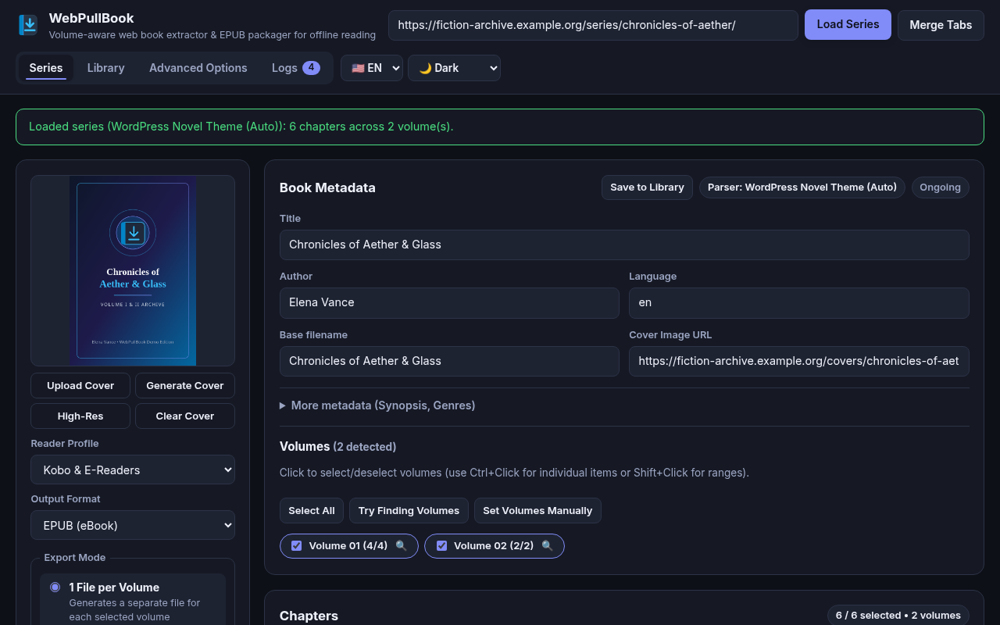
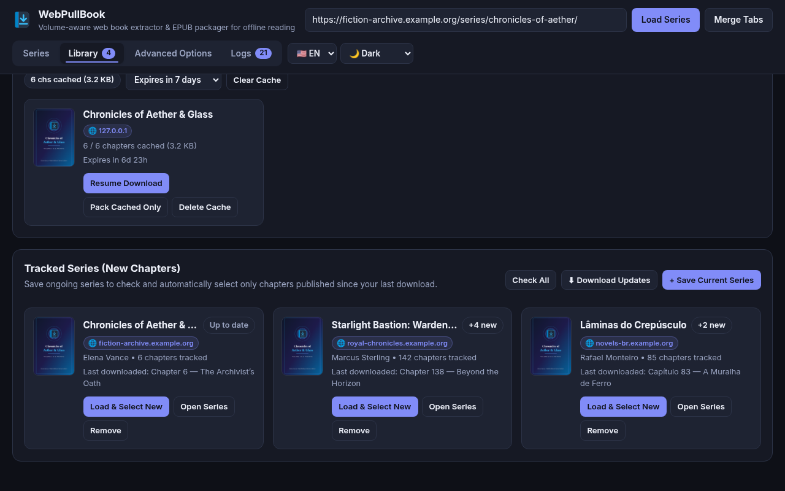
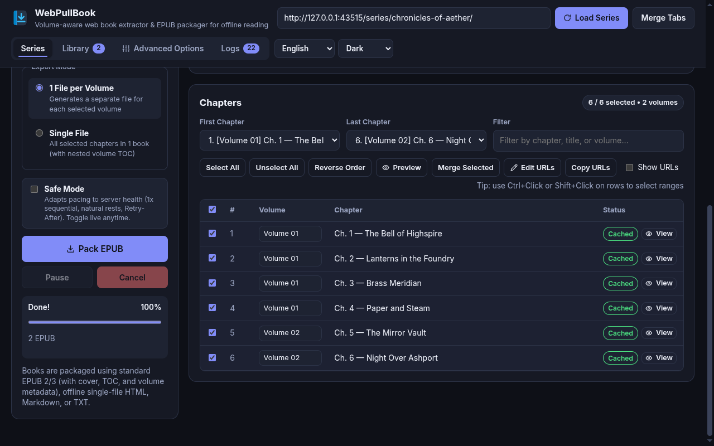

#  WebPullBook

[English](README.md) | **Português**

[](manifest.json)
[](#-primeiros-passos)
[](https://github.com/WiltonGabriel/WebPullBook/releases)
[](src/core/zip.js)
[](LICENSE)
[](https://github.com/WiltonGabriel/WebPullBook/actions/workflows/ci.yml)

**WebPullBook** é uma extensão de navegador open source (Chrome, Edge, Brave e Firefox 128+) sem dependências de runtime para **converter páginas web em EPUB** (**Web-to-EPUB**): extrai webnovels, light novels, ficções seriadas, fanfics, blogs, documentações e abas abertas para arquivos **EPUB 2 / EPUB 3** (além de **HTML**, **Markdown** e **TXT**) organizados por volume para leitura offline no **Kindle**, **Kobo**, **Calibre** e celulares.

Repositório: https://github.com/WiltonGabriel/WebPullBook  
Site oficial: https://wiltongabriel.github.io/WebPullBook/pt/

[Funcionalidades](#-principais-funcionalidades) • [Instalação](#-primeiros-passos) • [Compatibilidade](#-compatibilidade) • [Perguntas Frequentes](#-perguntas-frequentes-faq) • [Como Ajudar](#-autoria-manutenção-e-contribuições)

---

## Visão Geral

Ler obras longas, artigos ou séries com muitos capítulos em abas do navegador dificulta a leitura offline e em leitores E-Ink, enquanto imprimir PDFs individuais de capítulos costuma gerar quebras de linha inadequadas e problemas de paginação. O WebPullBook busca e sanitiza o HTML localmente no próprio navegador (sem servidores intermediários) e empacota ebooks fluídos com capa, sumário navegável e metadados de série e volume no padrão EPUB.

### Casos de Uso Comuns

- **Webnovels, Light Novels & Fanfics:** Salve capítulos seriados agrupados por volume em EPUB 3 ou EPUB 2 compatível com Kindle (*Send to Kindle*), Kobo e Calibre.
- **Artigos, Blogs & Documentações:** Abra várias abas no navegador e use **Juntar Abas** para pré-visualizar, reordenar e gerar uma única coletânea ou livros independentes.
- **Sites Dinâmicos / Sem Índice Único:** Utilize o rastreamento automático de **"Próximo Capítulo"** ou o **Modo SPA / JavaScript** quando páginas exigirem renderização no navegador ou não possuírem página de índice.

### Principais Funcionalidades

- **Extração Automática & Modo SPA:** Captura o DOM direto da aba ativa, detecta capítulos e volumes em adaptadores estruturais ou páginas HTML genéricas, suporta **Modo SPA / JavaScript** com pausa automática em desafios anti-bot e oferece seletor visual **`🎯 Apontar`** com regras salvas por domínio.
- **Perfis de Leitor & Estrutura do Livro:** Predefinições para **Kindle (Moderno / Antigo)**, **Kobo**, **Padrão Moderno**, **Somente Texto** e **Padrão Antigo** ([guia](docs/READER_PRESETS.pt.md)), com **Sumário** no início do livro, **Página de Informações**, **Página Final do Livro (Colofão)** configurável e **Notas Pop-up EPUB 3**.
- **Pré-visualização, Edição, Mesclagem & Pipeline de Imagens:** Pré-visualize e edite capítulos antes de exportar, mescle capítulos selecionados, envie uma capa ou utilize a capa padrão gerada automaticamente (com o emblema do WebPullBook e o título da obra quando nenhuma capa é detectada na página) e empacote imagens com detecção por *magic bytes*, deduplicação por hash de conteúdo e fallback automático.
- **Seleção por Volumes/Intervalos & Juntar Abas:** Marque ou desmarque todos os volumes de uma vez, use **`Ctrl+Clique`** e **`Shift+Clique`** para selecionar volumes e capítulos em intervalo, ou combine abas abertas (**Juntar Abas**) em um único livro ou livros separados.
- **Modo Seguro Adaptativo, Latência Manual & Cache Local:** Ative o **Modo Seguro** durante a exportação (adapta o ritmo à latência do servidor e respeita `Retry-After`), ajuste a **latência manual entre capítulos (0–30.000 ms)** em Opções Avançadas de forma independente do Modo Seguro e retome downloads pelo cache em **IndexedDB (7 dias)**.
- **Biblioteca & Atualizações em Lote:** Acompanhe obras salvas (unificadas ou separadas por site) e baixe capítulos novos das séries acompanhadas com **Baixar Novidades**.
- **Pastas Personalizadas, Logs & 4 Temas:** Escolha a pasta de destino e estrutura de subpastas (`%Root%/%Author%/%Title%`), consulte logs de execução com filtros e alterne entre os temas **Claro**, **Escuro**, **Sépia** e **Meia-noite** no Chrome e Firefox 128+.

### Demonstração Visual



<details>
<summary>Mais Telas da Extensão (Prévia &amp; Edição, Biblioteca &amp; Cache, Opções Avançadas, Exportação EPUB)</summary>

| Pré-visualização e Edição de Capítulo | Biblioteca e Cache Local (IndexedDB) |
| :---: | :---: |
|  |  |

| Opções Avançadas e Perfis de Leitor | Exportação EPUB Concluída |
| :---: | :---: |
|  |  |

</details>

---

## Compatibilidade

A tabela de compatibilidade em quatro níveis (**Verificados e Testados**, **Adicionados, mas Não Testados Oficialmente**, **Potencialmente Compatíveis** e **Não Compatíveis**) fica em [docs/COMPATIBILITY.md](docs/COMPATIBILITY.md) e pode ser atualizada via Pull Request conforme novos sites forem testados.

---

## Primeiros Passos

> **Status Beta (`v1.6.1-beta`):** O WebPullBook está atualmente em Beta e ainda não foi publicado na Chrome Web Store ou no Firefox Add-ons. A instalação é feita manualmente utilizando o pacote oficial disponível em [GitHub Releases](https://github.com/WiltonGabriel/WebPullBook/releases).

### Instalação (Chrome / Chromium)

Não é necessário compilar código nem instalar pacotes.

1. Baixe o pacote `WebPullBook-v*.zip` na página de [Releases](https://github.com/WiltonGabriel/WebPullBook/releases) e extraia a pasta, **ou** clone este repositório:
   ```bash
   git clone https://github.com/WiltonGabriel/WebPullBook.git
   ```
2. Abra `chrome://extensions/` no Google Chrome (ou navegador baseado em Chromium).
3. Ative o **Modo do desenvolvedor** no canto superior direito.
4. Clique em **Carregar sem compactação** (*Load unpacked*) e selecione a pasta `WebPullBook/` contendo o [manifest.json](manifest.json).

### Instalação (Mozilla Firefox)

Compatível com **Firefox 128+** (Manifest V3):

1. Baixe o pacote `WebPullBook-v*.zip` em [Releases](https://github.com/WiltonGabriel/WebPullBook/releases) (ou clone este repositório).
2. Abra `about:debugging#/runtime/this-firefox` no Firefox.
3. Clique em **Carregar extensão temporária...** (*Load Temporary Add-on...*) e selecione o arquivo [manifest.json](manifest.json) (ou diretamente o `.zip`).

### Uso Básico

1. Abra no navegador a página de índice de capítulos (ou qualquer capítulo) da obra desejada.
2. Clique no ícone do **WebPullBook** na barra do navegador para abrir a aba de trabalho — metadados, volumes e capítulos são lidos a partir da aba ativa.
3. Escolha **1 Arquivo por Volume** ou **Arquivo Único**, selecione o **Perfil de Leitor** e o formato de saída (**EPUB**, **HTML**, **MD** ou **TXT**) e ajuste a seleção de capítulos se necessário.
4. Clique em **Empacotar EPUB**. Por padrão, os arquivos são salvos em `Downloads/WebPullBook/<Título>/` — ou em qualquer pasta do PC e estrutura de subpastas configurada em **Opções Avançadas → Arquivos & Padrão EPUB**.
5. Para acompanhar capítulos futuros, clique em **Salvar na Biblioteca**.

### Configurando Layouts Desconhecidos sem Programar

Ao abrir um site desconhecido, o WebPullBook verifica automaticamente se o **Modo SPA / JavaScript** é necessário e sugere seletores CSS quando possível. Para ajustar manualmente em **Opções Avançadas**, use **🎯 Apontar** diretamente na página ou clique em **Auto-detectar seletores**:

```text
Seleção de Parser:                   Genérico (Qualquer página HTML)
Seletor CSS da lista de capítulos:   .chapter-list a
Seletor CSS do conteúdo:             article .chapter-body
Seletor CSS de elementos a excluir:  .ads, .translator-note
```

### Formatos de Saída

- **EPUB 2 / EPUB 3 (`.epub`):** Empacotamento OCF padrão (`META-INF/container.xml`, `content.opf`, `toc.ncx`, `nav.xhtml` e capítulos em XHTML estrito) com capa e metadados de série/volume para leitores digitais, aplicativos mobile e computadores.
- **HTML Único (`.html`), Markdown (`.md`) e Texto Puro (`.txt`):** Formatos para leitura direta no navegador, aplicativos de notas ou arquivamento em texto simples.

---

## Estrutura do Projeto

```text
WebPullBook/
├── .github/                      # Templates de Issue/PR, Segurança, Conduta, Dependabot e workflows CI/Release/Pages/CodeQL
├── AGENTS.md                     # Instruções e regras de arquitetura para agentes de IA
├── CHANGELOG.md                  # Histórico de versões
├── CHROMEWEBSTORE.md             # Preparação para lojas, justificativa de permissões e privacidade
├── CONTRIBUTING.md               # Guia de desenvolvimento e criação de parsers
├── LICENSE                       # Licença MIT
├── README.md                     # Documentação (English)
├── README.pt.md                  # Documentação (Português)
├── manifest.json                 # Manifesto da extensão (MV3)
├── docs/
│   ├── COMPATIBILITY.md          # Tabela de compatibilidade em 4 níveis (editável via PR)
│   ├── READER_PRESETS.pt.md      # Guia de perfis de leitor (PT / EN)
│   └── SEO_AND_GITHUB_PAGES.md   # Guia operacional do GitHub Pages e Google Search Console
├── icons/                        # Ícones da extensão
├── scripts/                      # Linter (check.mjs), extrator de notas de release e validador do site
├── tests/                        # Testes unitários/snapshots (node:test), fixtures HTML e E2E Playwright Chromium
├── website/                      # Site estático oficial bilíngue para GitHub Pages (excluído do ZIP da extensão)
└── src/
    ├── background/
    │   └── service-worker.js     # Abre o workspace ao clicar no ícone e configura regra DNR Origin no Firefox
    ├── core/
    │   ├── base-parser.js        # BaseParser (OOP) e pipeline de capítulos
    │   ├── cache-store.js        # Cache persistente em IndexedDB com expiração (TTL)
    │   ├── dnr-rules.js          # Regras temporárias declarativeNetRequest de navegação
    │   ├── epub-builder.js       # Orquestração EPUB 2/3 e reescrita de links internos
    │   ├── epub-css.js           # Gerador de CSS para e-readers
    │   ├── epub-templates.js     # Templates OPF, NCX, NAV, Capa, Info, Fim e Sumário
    │   ├── image-processor.js    # Sniffing por magic bytes, hash dedup e fallback canvas
    │   ├── net-fetcher.js        # HTTP com charset, captura da aba ativa, TabRenderPool e segurança SPA
    │   ├── parser-engine.js      # Fachada de re-export dos módulos centrais
    │   ├── rate-limiter.js       # AdaptiveRateLimiter (Modo Seguro adaptativo e Retry-After)
    │   ├── sanitizer.js          # HtmlSanitizer -> XHTML válido, __cf_email__, nextPrevUrls
    │   ├── selector-utils.js     # Gerador de seletores CSS para captura visual
    │   ├── text-utils.js         # Normalização, volumes, caminhos e capas
    │   ├── xhtml-serializer.js   # Serializador XHTML estrito e notas pop-up EPUB 3
    │   └── zip.js                # Empacotador ZIP nativo via CompressionStream
    ├── exporters/
    │   ├── index.js              # ExporterRegistry (EPUB, HTML, Markdown, TXT)
    │   ├── base-exporter.js      # BaseExporter com conversão DOM -> Markdown/TXT
    │   ├── epub-exporter.js      # Exportador EPUB 2/3
    │   ├── html-exporter.js      # Exportador HTML único offline
    │   ├── markdown-exporter.js  # Exportador Markdown (.md)
    │   └── txt-exporter.js       # Exportador Texto Puro (.txt)
    ├── parsers/
    │   ├── index.js              # ParserRegistry com ranking por pontuação DOM
    │   ├── generic-html.js       # Extrator heurístico, detecção de seletores e paginação
    │   ├── wp-lightnovel.js      # Adaptador estrutural para temas WordPress de ficção
    │   ├── madara-theme.js       # Adaptador estrutural para temas estilo Madara
    │   ├── royalroad.js          # Adaptador para fictions, volumes e notas ocultas
    │   ├── scribblehub.js        # Adaptador com paginação/AJAX e detecção anti-bot
    │   └── novelmania.js         # Adaptador para índice paginado via API e volumes
    └── workspace/
        ├── cache-sessions-ui.js  # Visualização e retomada de sessões salvas no cache IndexedDB
        ├── chapter-modals.js     # Pré-visualização de capítulo, edição inline e modal de mesclagem
        ├── chapters-ui.js        # Tabela de capítulos, chips de volumes e seleção Ctrl/Shift
        ├── cover-ui.js           # Upload de capa, gerador de capa padrão com logo e prévia
        ├── directory-handle.js   # Persistência de pasta via File System Access API e prévia de caminho
        ├── domain-rules-ui.js    # Interface de regras de seletores CSS salvas por domínio
        ├── download-storage.js   # Gravação via chrome.downloads e FileSystemDirectoryHandle
        ├── export-runner.js      # Fila de exportação, Pausar/Cancelar, Modo Seguro e saída
        ├── i18n.js               # Dicionários e tradução da interface (PT / EN)
        ├── library-ui.js         # Biblioteca de séries salvas e fluxo de atualização em lote
        ├── library-view.js       # Organização unificada vs. separada por site e selos de origem
        ├── logger.js             # Logs de diagnóstico, filtros e relatório pós-exportação
        ├── options-storage.js    # Opções persistentes, sincronia de perfis e isolamento de seletores
        ├── series-loader.js      # Carregamento da obra, auto-SPA, capa padrão e auto-seletores CSS
        ├── settings-io.js        # Modais de confirmação de restauração e exportação/importação JSON
        ├── state.js              # Estado centralizado, perfis e utilitários compartilhados
        ├── tab-picker.js         # Modal de juntar abas e seletor visual ponto-a-ponto
        ├── theme-init.js         # Inicialização de tema sem FOUC
        ├── volume-modals.js      # Modais de definição manual de volumes e edição de lista de URLs
        ├── workspace.css         # Estilos adaptativos claro/escuro/sépia/meia-noite
        ├── workspace.html        # Interface principal, Biblioteca e modais nativos
        └── workspace.js          # Orquestrador enxuto ligando eventos e ciclo de vida
```

---

## Onde Obter Ajuda

- **Logs de execução:** Acesse a aba **Logs** dentro da própria extensão e clique em **Baixar Log** para salvar o registro detalhado de rede ou extração.
- **Matriz de compatibilidade:** Veja [docs/COMPATIBILITY.md](docs/COMPATIBILITY.md) para consultar os sites e padrões estruturais suportados.
- **Reportar bugs ou sugerir suporte a layouts:** Abra uma issue na aba **Issues** do repositório no GitHub descrevendo a estrutura HTML (seletores da lista de capítulos e do texto) junto com o log correspondente.
- **Documentação para desenvolvedores & testes:** Consulte [CONTRIBUTING.pt.md](docs/pt/CONTRIBUTING.pt.md) (ou o original em inglês [CONTRIBUTING.md](CONTRIBUTING.md)) e [AGENTS.md](AGENTS.md) para detalhes da arquitetura, suíte de testes (`node:test`, `EPUBCheck`, Playwright E2E) e instruções para criar novos adaptadores de parser.
- **Histórico de versões e segurança:** Veja [CHANGELOG.pt.md](docs/pt/CHANGELOG.pt.md) (ou [CHANGELOG.md](CHANGELOG.md)), [SECURITY.pt.md](docs/pt/SECURITY.pt.md) e [CODE_OF_CONDUCT.pt.md](docs/pt/CODE_OF_CONDUCT.pt.md). Toda a documentação espelho em português está reunida em [docs/pt/](docs/pt/README.md).

---

## Perguntas Frequentes (FAQ)

- **Funciona no Kindle e no Kobo?** Sim. Escolha **Kindle (Antigo)** (EPUB 2 clássico compatível com envio pelo *Send to Kindle* da Amazon), **Kindle (Moderno)** (EPUB 3 a 1200px para conversão via Calibre/USB) ou **Kobo e Leitores Digitais** (EPUB 3 a 1080px mantendo as cores originais). Veja detalhes em [docs/READER_PRESETS.pt.md](docs/READER_PRESETS.pt.md).
- **Como o WebPullBook lida com meus dados e requisições de rede?** O WebPullBook não possui servidores intermediários, telemetria ou análise de uso. Toda a análise de HTML, sanitização XHTML, conversão de imagens e empacotamento ZIP/EPUB acontece localmente dentro do seu navegador, e suas preferências/biblioteca/cache ficam salvos localmente no dispositivo (`chrome.storage.local` e `IndexedDB`). Seu navegador realiza apenas requisições HTTP/HTTPS diretas aos sites e CDNs das obras que você escolheu baixar (utilizando os cookies da sua sessão aberta quando necessário, com fallback anônimo em erros de CDN). Consulte a [Política de Privacidade](https://wiltongabriel.github.io/WebPullBook/pt/privacy.html).
- **Um site específico não carregou os capítulos. O que fazer?** O WebPullBook tenta renderização SPA e detecção heurística automaticamente; para ajustes em layouts personalizados, use **🎯 Apontar** nas **Opções Avançadas**, clique em **Auto-detectar seletores** e salve uma **Regra por Domínio** — ou abra uma issue utilizando o modelo de suporte a sites.

---

## Autoria, Manutenção e Contribuições

O WebPullBook foi criado e é mantido por **Wilton Gabriel** ([@WiltonGabriel](https://github.com/WiltonGabriel)), contando com a colaboração de contribuidores da comunidade open source. O projeto é distribuído sob a [Licença MIT](LICENSE) e segue nosso [Código de Conduta](docs/pt/CODE_OF_CONDUCT.pt.md).

### Formas de Contribuir — Destaque para Desenvolvimento e Adição de Parsers

Contribuições voltadas para **parsers (adaptadores de sites e heurísticas de extração)** são a forma de maior impacto para expandir o alcance do WebPullBook:

- **Desenvolver e adicionar novos parsers (`src/parsers/`):** Quando uma plataforma de web novels, CMS ou portal utiliza APIs JSON paginadas, listas de capítulos via AJAX ou estruturas DOM próprias que o extrator genérico não cobre sozinho, crie uma nova subclasse de `BaseParser` em [src/parsers/](src/parsers/index.js) e registre-a acompanhada de fixtures HTML anonimizadas em [tests/fixtures/](tests/fixtures/snapshots.json). Veja o passo a passo completo em [CONTRIBUTING.md](CONTRIBUTING.md#adding-a-parser-adapter) ou na [página Como Contribuir](https://wiltongabriel.github.io/WebPullBook/pt/contributing.html).
- **Aprimorar o extrator heurístico genérico (`src/core/` & `src/parsers/generic-html.js`):** Evolua o [`BaseParser`](src/core/base-parser.js), o [`GenericHtmlParser`](src/parsers/generic-html.js) ou o [`HtmlSanitizer`](src/core/sanitizer.js) para que sites, blogs e domínios espelho funcionem automaticamente sem depender de regras específicas por domínio.
- **Testar sites e atualizar a compatibilidade:** Teste o WebPullBook em novos sites e abra um PR atualizando [docs/COMPATIBILITY.md](docs/COMPATIBILITY.md) (o site oficial sincroniza as tabelas automaticamente a partir desse documento).
- **Reportar layouts ou bugs com logs de execução:** Abra uma issue em [Issues](https://github.com/WiltonGabriel/WebPullBook/issues) usando o modelo *New Site Layout / Adapter Support* ou *Bug Report* e anexe o arquivo salvo em **Logs → Baixar Log**.
